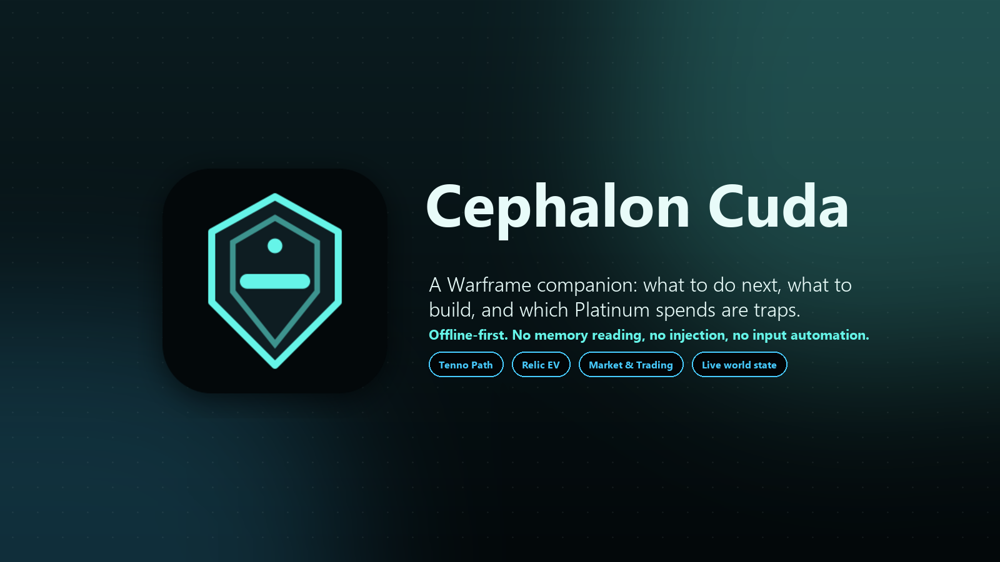
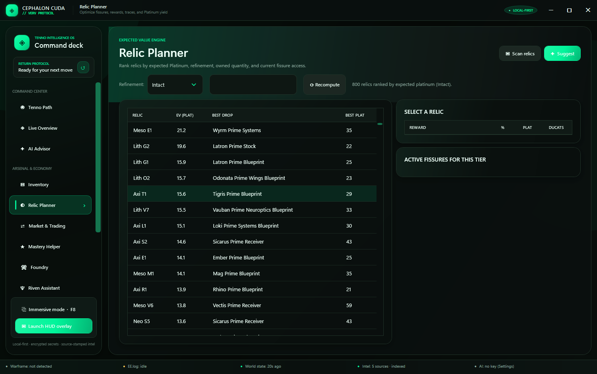
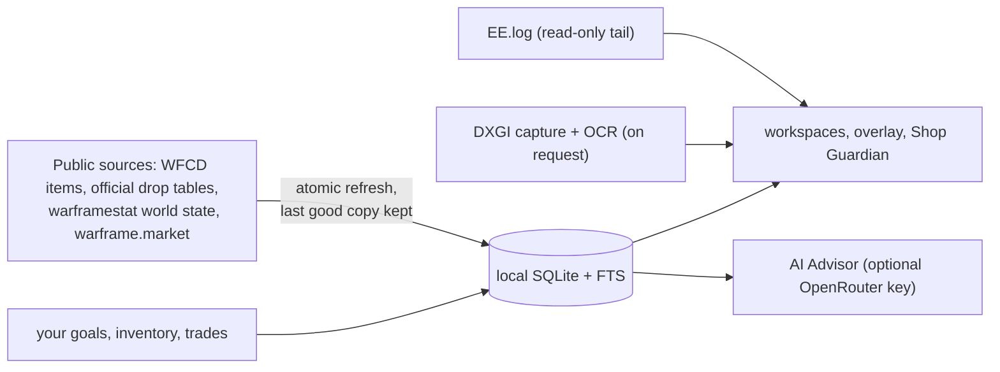
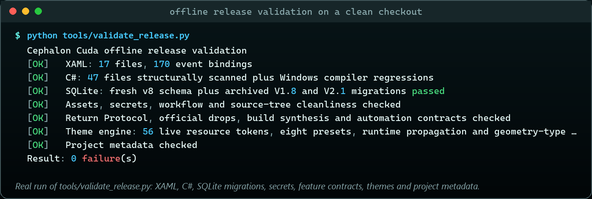

<div align="center">



[](https://github.com/SenjuWoo/Cephalon-Cuda/actions/workflows/ci.yml)
[](https://github.com/SenjuWoo/Cephalon-Cuda/releases/latest)
[](#install)
[](src/CephalonCuda/CephalonCuda.csproj)
[](LICENSE)

**[Install](#install)** · **[Tour](#a-two-minute-tour)** · **[Workspaces](#workspaces)** · **[Privacy and game safety](#privacy-and-game-safety)** · **[How it works](#how-it-works)** · **[Changelog](CHANGELOG.md)**

</div>

Cephalon Cuda is a Windows companion for **new, active and returning Warframe players**. It turns
scattered systems into a practical decision layer: what to do next, what to build, where an item
comes from, whether an old build is still worth investing in, and which Platinum purchases are
traps. It is offline-first: your own state stays in a local SQLite database, and public game data
refreshes into a source-stamped knowledge layer that keeps the last good copy when a source fails.

## What you get

- **Tenno Path and Return Protocol.** A 21-objective account roadmap, a goal stack, redemption codes and a **Just Got Back?** re-entry plan built from your real `EE.log` activity, never from account data the game does not expose.
- **Live Overview.** Void fissures (Steel Path and Void Storm filters), open-world cycles, sortie, archon hunt, alerts, invasions and Baro Ki'Teer, with countdowns that tick from each expiry timestamp.
- **Relic Planner.** Expected-Platinum ranking for every relic and refinement, best drop per relic, the fissures open for that tier right now, and OCR reward scanning.
- **Market & Trading.** warframe.market v2 orders, price history, a trade ledger and listing sync with your own warframe.market account.
- **Shop Guardian.** Flags poor-value Platinum spends (credits, routine resources, random mod packs, Foundry rushes) and checks market alternatives first.
- **Inventory, Mastery Helper, Foundry timers and Riven Assistant**, plus a **Live Data & Intel** dashboard that shows the health, size and last sync of every source.
- **Streaming AI Advisor** (optional, your own OpenRouter key) that retrieves from the same local database the app shows you.
- **Overlay HUD, capture, OCR and Immersive Mode**, and eight full-interface palettes: Verv, Lotus, Orokin, Entrati, Corpus, Grineer, Void and High Contrast.




## Install

1. Download `Cephalon_Cuda_<version>_Nexus_Release.zip` from the [latest release](https://github.com/SenjuWoo/Cephalon-Cuda/releases/latest).
2. Extract it **anywhere outside Program Files**.
3. Run `CephalonCuda.exe`. It is a self-contained single file: no .NET runtime to install.
4. Add an OpenRouter key in Settings **only** if you want the AI Advisor.

Needs 64-bit Windows 10 or 11, the WebView2 runtime for the embedded advisor panel (built into
Windows 11), and internet for live data. Run Warframe in Borderless or Windowed mode for the
overlay and capture features.

Local data lives in `%LocalAppData%\CephalonCuda`. To uninstall, delete the exe; delete that
folder too only if you also want settings, caches and encrypted API credentials gone.

## A two-minute tour

1. **Tenno Path** opens first. Work down **Next Steps**, pin what matters, and add your own goals in **Goal Stack**.
2. Coming back after a break? Open **Just Got Back?**: it remembers your previous session gap and lists ready Foundry claims, the next roadmap objective, unclaimed codes, stale data and old builds to revalidate.
3. **Live Overview** shows what is open right now; tick **Steel Path** or **Void Storms** to filter fissures.
4. Before cracking relics, sort them in **Relic Planner** and pick a refinement; the side panel lists the fissures open for that tier.
5. Before spending Platinum, run the item through **Shop Guardian** on Tenno Path.
6. Launch the HUD overlay from the rail. Overlay hotkeys: **F6** lock, **F7** interactive, **F9** hide, **F10** scan, **F11** analyze, **F12** chat; **F8** toggles Immersive Mode from the main window.

### Return Protocol

**Just Got Back?** uses trustworthy local activity from `EE.log`, remembers the previous session
gap, and builds a controlled re-entry plan instead of dumping every new system on the player. It
prioritizes ready Foundry claims, the next unresolved roadmap objective, your goals, unclaimed
redemption codes, stale data sources, old builds that need revalidation, and live time-limited
opportunities. Return state is **never fabricated** from inaccessible account data: confirm play
activity manually, edit goals, and control automatic briefings.

## Workspaces

| Workspace | What it does |
|---|---|
| Tenno Path | Roadmap, Next Steps, Navigator, Shop Guardian, Redeem & Claim, Goal Stack, Just Got Back? |
| Live Overview | Fissures, cycles, sortie, archon hunt, alerts, invasions, Baro, news |
| AI Advisor | Streaming OpenRouter chat grounded in the local database (optional key) |
| Inventory | Owned items and riven disposition checks |
| Relic Planner | Expected-value ranking, refinements, active fissures, OCR reward scan |
| Market & Trading | v2 orders, statistics, ledger, listing sync |
| Mastery Helper | Mastery catalog and progress |
| Foundry | Build timers and ready claims |
| Riven Assistant | Riven weapons and live auctions |
| Live Data & Intel | Source health, licensed JSON feeds, database search |
| Overlay & OCR | HUD overlay, capture and OCR settings |
| Settings | Themes, UI scale, startup page, keys, automation |

## Privacy and game safety

Cephalon Cuda does **not** read game memory, inject code, automate input, or play the game. It uses
read-only `EE.log` events, visual capture/OCR, public endpoints, and information you enter or
confirm. API keys are encrypted with Windows DPAPI. See [`PRIVACY_AND_DATA.md`](PRIVACY_AND_DATA.md).

## How it works



- **Externals only.** `EE.log` tail, screen capture with OCR, and public APIs. No memory reading, injection or input automation, ever.
- **Source-stamped intel.** Every third-party fact keeps its source and freshness; community tiers and builds stay opinions, imported from licensed JSON feeds rather than scraped.
- **Fail closed.** A failed or malformed refresh never replaces the last healthy cache, and the schema only ever migrates forward.

### Honest status

Verified in this tree: Release build with warnings as errors, the full UI `--smoke` cycle (every
workspace and theme), live `--verify-data` against every integration, and the offline contracts in
[`VALIDATION_REPORT.md`](VALIDATION_REPORT.md).

Not claimed: visibility into private account progression Digital Extremes does not expose; that
community build votes or tiers are truth (they remain source-stamped opinions); an automated
Overframe scraper (not shipped, see [`docs/COMMUNITY_INTEL_SCHEMA.md`](docs/COMMUNITY_INTEL_SCHEMA.md)).

## Build from source

On 64-bit Windows 10 or 11 with any .NET 10 or newer SDK:

```bat
BUILD_V2.2.bat
```

The pipeline restores, builds Release with warnings as errors, publishes a self-contained
`win-x64` executable, runs `--smoke` and `--verify-data`, then writes Nexus and Source folders and
zips under `dist`. A failed build, smoke test or live verification stops it before packaging.

```bat
run.bat                               :: Debug build and launch
publish.bat                           :: single-file publish + smoke test
publish\CephalonCuda.exe --smoke       :: instantiate every view and the overlay, exit 0 = pass
publish\CephalonCuda.exe --verify-data :: live API check, exit code = failure count
python tools\validate_release.py       :: offline contracts (run on a clean tree)
```

Reports and crash logs land in `%LocalAppData%\CephalonCuda\logs`.




More detail: [`docs/TENNO_PATH.md`](docs/TENNO_PATH.md), [`docs/DATA_PIPELINE.md`](docs/DATA_PIPELINE.md),
[`docs/COMMUNITY_INTEL_SCHEMA.md`](docs/COMMUNITY_INTEL_SCHEMA.md).

## Credits

Warframe, Tenno, and related names are trademarks of Digital Extremes. This project is unofficial.
Third-party notices: [`THIRD_PARTY_NOTICES.md`](THIRD_PARTY_NOTICES.md).

## License

[MIT](LICENSE) · [Changelog](CHANGELOG.md)
